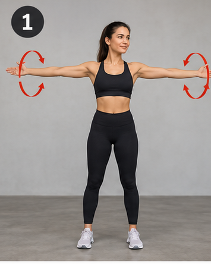
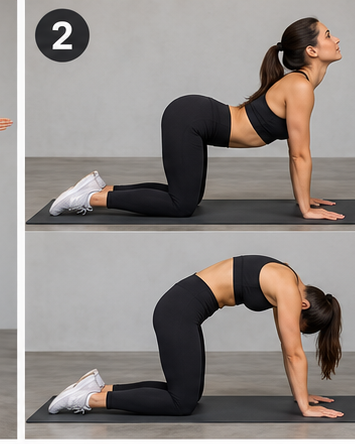
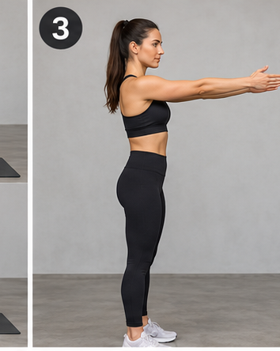
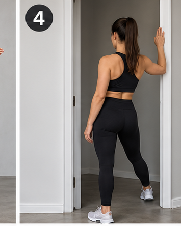
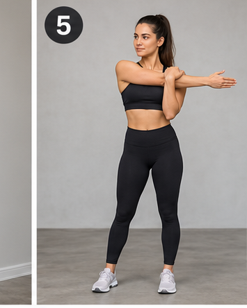
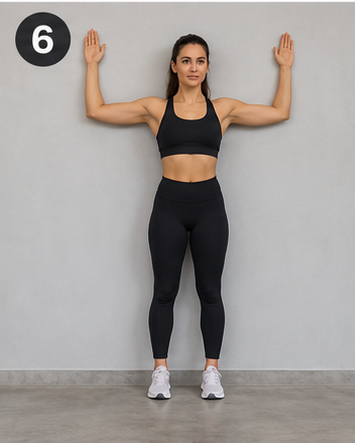
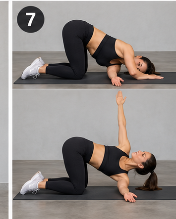
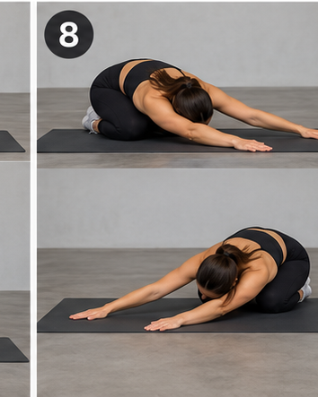
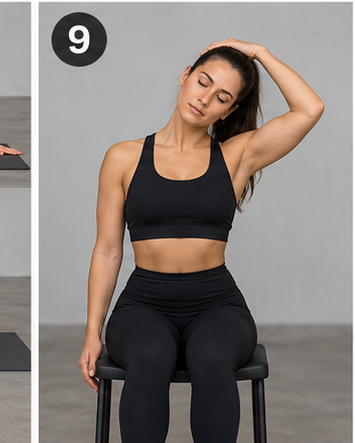
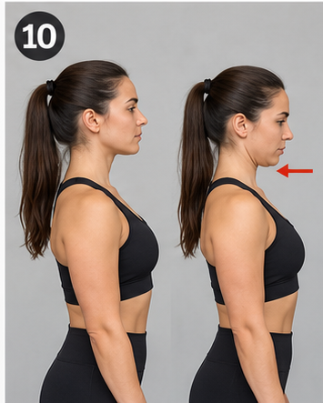

# Upper Body Stretching & Mobility

**Trvanie:** približne 23 minút  
**Pomôcky:** bez vybavenia (stena a zárubňa pri dvoch cvikoch)  
**Zameranie:** ramená, hrudník, lopatky, chrbát a krk

Cviky rob pomaly, bez švihania a bez bolesti. Pri statickom strečingu pokojne dýchaj.

## 1. Mobilita a rozhýbanie — 5 min

### 1. Arm Circles

**2 série × 30 s dopredu + 30 s dozadu — 2 min**

Vystri ruky do strán a rob kontrolované kruhy ramenami. Začni menšími a postupne zväčšuj rozsah.

### 2. Cat–Cow

**2 série × 8 opakovaní — 1,5 min**

Na štyroch striedavo vyhrb chrbát a prehni ho. Pohyb veď cez chrbticu, bez zakláňania krku nasilu.

### 3. Scapular Protraction & Retraction

**2 série × 10 opakovaní — 1,5 min**

Predpaž ruky. Bez ohýbania lakťov posúvaj lopatky od seba a potom ich jemne pritiahni k sebe.

## 2. Hrudník a ramená — 8 min

### 4. Doorway Chest Stretch

**2 série × 40 s na stranu — 3 min**

Predlaktie polož na zárubňu, lakeť približne vo výške ramena. Jemne otoč trup od ruky, až kým cítiš ťah v hrudníku.

### 5. Cross-Body Shoulder Stretch

**2 série × 30 s na ruku — 2 min**

Ruku natiahni pred seba a veď ju naprieč hrudníkom. Druhou rukou ju jemne pritiahnutím podopri nad lakťom.

### 6. Wall Angels

**2 série × 8 pomalých opakovaní — 3 min**

Opri chrbát o stenu. Ruky posúvaj z polohy W smerom hore a späť. Rebrá drž dole a neprehýbaj kríže.

## 3. Lopatky a chrbát — 6 min

### 7. Thread the Needle

**2 série × 30 s na stranu — 2,5 min**

Na štyroch prevleč jednu ruku popod druhú a polož rameno na podložku. Jemne rotuj hrudník, boky nechaj stabilné.

### 8. Child's Pose with Side Reach

**2 série × 40 s na stranu — 3,5 min**

Sadni si na päty, natiahni ruky pred seba a presuň ich do jednej strany. Pocítiš natiahnutie širokého svalu chrbta na opačnej strane.

## 4. Krk a záverečné uvoľnenie — 4 min

### 9. Upper Trapezius Stretch

**2 série × 30 s na stranu — 2 min**

Seď vzpriamene. Nakloň hlavu k jednému ramenu, druhé rameno nechaj spustené. Rukou môžeš len jemne pridať tlak.

### 10. Chin Tucks

**2 série × 10 opakovaní (5 s výdrž) — 2 min**

Pozeraj rovno pred seba a zasuň bradu vodorovne dozadu, akoby si robil dvojitú bradu. Hlavu neskláňaj.

## Checklist

- [ ] Arm Circles
- [ ] Cat–Cow
- [ ] Scapular Protraction & Retraction
- [ ] Doorway Chest Stretch
- [ ] Cross-Body Shoulder Stretch
- [ ] Wall Angels
- [ ] Thread the Needle
- [ ] Child's Pose with Side Reach
- [ ] Upper Trapezius Stretch
- [ ] Chin Tucks

---

**Frekvencia:** 2–4× týždenne. Pred silovým tréningom uprednostni dynamickú mobilitu; dlhšie statické výdrže si nechaj po tréningu alebo na recovery day. Pri ostrej bolesti cvik vynechaj.

**Poznámka k obrázkom:** Tento Markdown obsahuje textový plán; ilustrácie jednotlivých cvikov z predchádzajúcej odpovede sa nedajú automaticky preniesť do súboru. 
